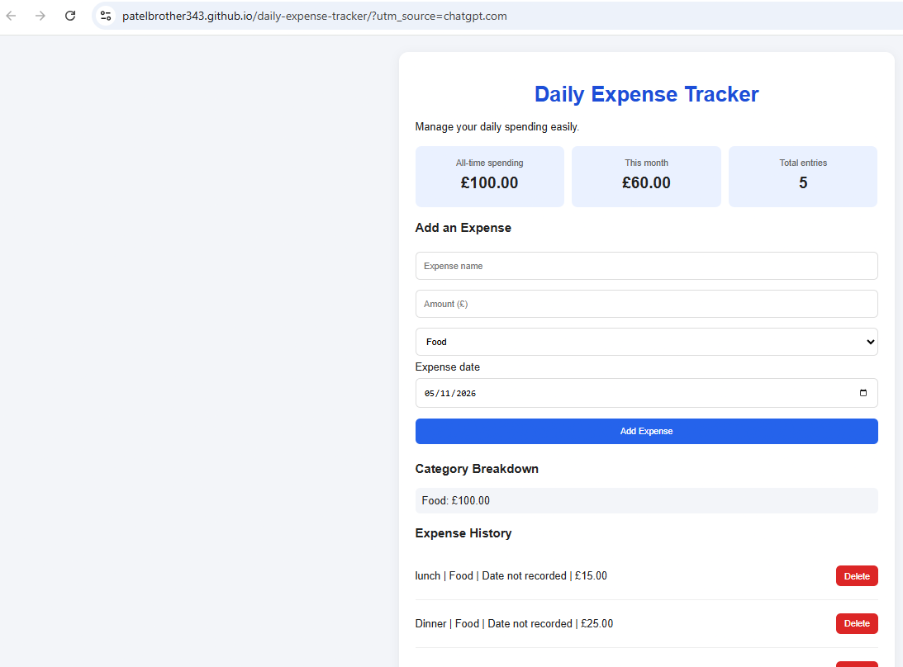

# Daily Expense Tracker

A simple, free, open-source expense tracking application built with HTML, CSS and JavaScript.

## Live Demo

[Open Daily Expense Tracker](https://patelbrother343.github.io/daily-expense-tracker/)

## App Screenshot

## Features

- Add daily expenses.
- Choose expense categories.
- Record expense dates.
- Calculate all-time spending.
- Calculate current-month spending.
- View category-wise spending.
- Delete expenses.
- Save expenses in browser storage.
- Responsive layout for mobile and desktop.

## Screenshots

Screenshots of the application will be added here.

## Getting Started

No installation or additional software is required.

### Option 1: Use the Live Website

Visit:

https://patelbrother343.github.io/daily-expense-tracker/

### Option 2: Run Locally

1. Download or clone this repository.
2. Open the downloaded project folder.
3. Double-click `index.html`.
4. The application will open in your web browser.

## Technology Used

- HTML
- CSS
- JavaScript
- Browser Local Storage

## Data Storage

Expenses are stored locally in your browser using Local Storage.

Your data is not automatically synchronised between different devices or browsers. Clearing browser storage may delete saved expenses.

## Contributing

Contributions, suggestions and bug reports are welcome.

Please read [CONTRIBUTING.md](CONTRIBUTING.md) before submitting contributions.

## Licence

This project is distributed under the MIT License. See [LICENSE](LICENSE) for details.

## Project Status

This project is under active development. Feedback and genuine contributions are welcome.
